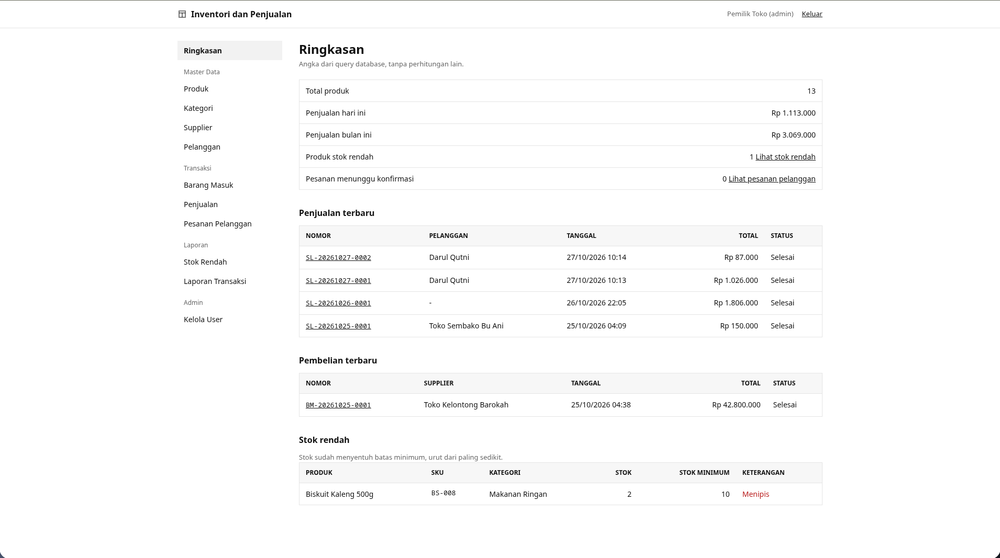
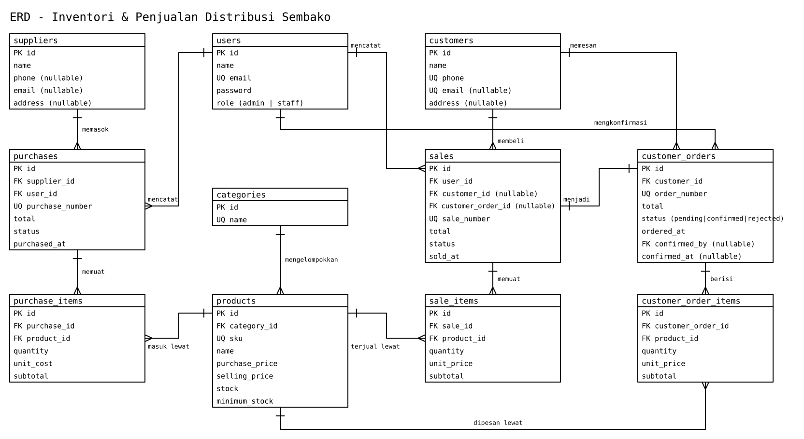

# Inventori dan Penjualan

Aplikasi inventori dan penjualan untuk distribusi sembako: catat barang masuk, jual barang, pantau stok, dan terima pesanan dari pelanggan. Dibuat dengan Laravel untuk UTS Web Programming 2.

## Alur singkat

1. Admin dan staff masuk dengan email dan password.
2. Stok bertambah lewat transaksi Barang Masuk (pembelian dari supplier).
3. Stok berkurang lewat Penjualan, atau lewat konfirmasi pesanan pelanggan.
4. Pelanggan masuk cukup dengan nama dan telepon, memesan dari katalog, lalu staff mengkonfirmasi pesanannya. Stok baru berkurang saat konfirmasi, bukan saat pesanan dibuat.

## Tech Stack

- Laravel, PHP 8.3+, Blade
- MySQL / MariaDB (test berjalan di SQLite in-memory)
- Satu file CSS polos (`public/css/app.css`), font sistem, tanpa Tailwind, tanpa Vite, tanpa npm

## Instalasi

```bash
git clone <url-repo-ini>
cd inventorySalesRaravel
composer install
cp .env.example .env
php artisan key:generate
```

Isi koneksi database di `.env`, lalu:

```bash
php artisan migrate --seed
php artisan serve
```

Buka http://127.0.0.1:8000. Tidak ada langkah npm karena aplikasi tidak memakai build asset.

## Akun Demo

| Role   | Email                 | Password |
|--------|-----------------------|----------|
| Admin  | admin@inventory.test  | password |
| Staff  | staff@inventory.test  | password |

Pelanggan tidak perlu akun: di halaman masuk ada tautan "Masuk sebagai Pelanggan", cukup isi nama dan telepon.

## Fitur

- Login dan logout, password di-hash, semua route aplikasi di dalam middleware `auth`, tamu dialihkan ke login
- Role Admin dan Staff. Staff bisa membuat pembelian dan penjualan serta melihat data; mengelola user, laporan, dashboard, dan membatalkan transaksi hanya Admin, ditolak 403 di server kalau staff mengetik URL admin langsung
- Master data: Produk (SKU unik, kategori, harga beli dan jual, stok minimum), Kategori, Supplier, Pelanggan. Stok awal produk selalu 0 dan hanya berubah lewat transaksi
- Barang Masuk (pembelian): nomor `BM-YYYYMMDD-XXXX`, banyak item, stok bertambah setelah transaksi tersimpan
- Penjualan: nomor `SL-YYYYMMDD-XXXX`, banyak item, stok diperiksa dengan `lockForUpdate()`, total dihitung server dari harga di database, kalau satu item stoknya kurang seluruh transaksi ditolak
- Katalog pelanggan: masuk dengan nama dan telepon (identitas disimpan di session, tanpa password), pilih barang dan jumlah, keranjang disimpan di session, buat pesanan bernomor `PP-YYYYMMDD-XXXX`
- Pesanan pelanggan masuk ke halaman staff. Konfirmasi staff membuat penjualan baru dan stok berkurang saat itu; kalau stok kurang, konfirmasi gagal total dan pesanan tetap menunggu; tolak tidak mengubah stok
- Pembatalan transaksi (hanya Admin): membatalkan pembelian mengurangi stok kembali, membatalkan penjualan mengembalikan stok, dalam transaction yang sama
- Dashboard ringkas dari query database, laporan stok rendah (`stock <= minimum_stock`), laporan transaksi dengan filter tanggal
- Search, filter, dan pagination di semua daftar, filter tetap ada saat pindah halaman (`withQueryString()`)
- Produk, kategori, supplier, dan pelanggan yang sudah dipakai transaksi tidak bisa dihapus

## ERD dan Relasi



[Lihat atau edit file sumber Excalidraw (erd-sembako.excalidraw)](./erd-sembako.excalidraw)

Diagram di atas adalah skema yang sedang jalan, sudah memuat tabel pelanggan dan pesanan, dan sama dengan teks relasi di bawah.

```
users
  id PK
  name, email UNIQUE, password, role (admin|staff)

categories
  id PK, name

suppliers
  id PK, name, phone, email, address

customers
  id PK
  name
  phone UNIQUE   (dipakai form masuk pelanggan, tanpa password)
  email, address

products
  id PK
  category_id FK -> categories.id
  sku UNIQUE
  name
  purchase_price, selling_price
  stock, minimum_stock

purchases                        purchase_items
  id PK                            id PK
  purchase_number UNIQUE           purchase_id FK -> purchases.id
  supplier_id FK -> suppliers.id   product_id  FK -> products.id
  user_id     FK -> users.id       quantity, unit_cost, subtotal
  total, status, purchased_at

sales                            sale_items
  id PK                            id PK
  sale_number UNIQUE               sale_id    FK -> sales.id
  user_id          FK -> users.id  product_id FK -> products.id
  customer_id      FK -> customers.id, nullable (walk-in)
  customer_order_id FK -> customer_orders.id, nullable (dari konfirmasi pesanan)
  total, status, sold_at

customer_orders                  customer_order_items
  id PK                            id PK
  order_number UNIQUE (PP-)        customer_order_id FK -> customer_orders.id
  customer_id FK -> customers.id   product_id  FK -> products.id
  total (preview saat pesan)       quantity
  status (pending|confirmed|rejected)  unit_price (snapshot), subtotal
  ordered_at
  confirmed_by FK -> users.id, nullable
  confirmed_at, nullable
```

Relasi Eloquent utama: `Sale hasMany SaleItem`, `Sale belongsTo Customer` (nullable), `Sale belongsTo CustomerOrder` (nullable), `Customer hasMany CustomerOrder`, `CustomerOrder belongsTo Customer`, `CustomerOrder hasMany CustomerOrderItem`, `CustomerOrder belongsTo User` sebagai `confirmedBy`, `CustomerOrderItem belongsTo Product`.

## Aturan Bisnis

| Aturan | Detail |
|--------|--------|
| Harga dari server | Harga beli dan jual diambil dari database; total selalu dihitung server, input browser tidak dipercaya |
| Kunci stok | `Product::lockForUpdate()` saat penjualan dan konfirmasi pesanan, supaya dua transaksi bersamaan tidak menjual melebihi stok |
| Atomic | Setiap pembelian, penjualan, dan konfirmasi pesanan dibungkus `DB::transaction`; satu item gagal, semuanya dibatalkan |
| Stok tidak negatif | Pengecekan stok cukup untuk semua item sebelum ada pengurangan (SaleService dan CustomerOrderService::confirm) |
| Stok rendah | Satu aturan di semua halaman: `stock <= minimum_stock`, tidak ada angka ajaib |
| Hapus data master | Produk, kategori, supplier, dan pelanggan yang sudah dipakai transaksi ditolak dihapus |

## Pertanyaan Interview (dengan titik jawab di kode)

- Kenapa Sale punya `hasMany` ke SaleItem? `app/Models/Sale.php`, relasi `items()`, dipakai di `SaleService::create` untuk simpan banyak item satu header.
- Di mana sistem memastikan stok tidak negatif? `app/Services/SaleService.php` fase 1 (cek semua item dengan `lockForUpdate` sebelum mengurangi), dan `app/Services/CustomerOrderService.php` method `confirm` dengan pola yang sama.
- Kenapa total dihitung server? `SaleService::create`: subtotal dihitung dari `selling_price` di database dikali quantity; hidden input form hanya mengirim `product_id` dan `quantity`.
- Apa risiko pengurangan stok di luar `DB::transaction`? Kalau gagal setengah jalan, sebagian item sudah mengurangi stok tanpa transaksi tercatat; rollback transaction mencegahnya.
- Bagaimana staff ditolak dari fungsi admin? `app/Http/Middleware/AdminMiddleware.php` memeriksa role di server dan `abort(403)`; menyembunyikan tombol saja tidak dihitung.
- Dua penjualan memproses stok yang sama hampir bersamaan? `lockForUpdate()` mengunci baris produk sampai transaction pertama selesai, penjualan kedua membaca stok terbaru.
- Validasi SKU unik? `app/Http/Requests/ProductRequest.php` pakai `Rule::unique` plus kolom `sku` UNIQUE di migration `create_products_table`.
- Ubah aturan minimum stock? Ubah `minimum_stock` lewat form produk; dampaknya langsung terlihat di dashboard, laporan stok rendah, dan label Menipis karena semuanya membaca kolom itu.
- Kenapa `Sale belongsTo Customer` dan `customer_id` boleh null? Penjualan walk-in tidak punya pelanggan terdaftar; kolomnya nullable dan ditampilkan "-" di detail.
- Kenapa stok tidak berkurang saat pesanan dibuat? `CustomerOrderService::create` hanya menyimpan pesanan; pengurangan stok ada di method `confirm`.
- Kenapa keranjang di session bukan tabel? Keranjang sifatnya sementara sebelum jadi pesanan; data permanen baru dibuat saat "Buat Pesanan".
- Kenapa pelanggan tanpa password? Ini identitas session untuk demo UTS: siapa pun yang tahu telepon bisa memakai identitas itu, bukan autentikasi yang aman untuk produksi.
- Di mana konfirmasi mengubah pesanan jadi sale? `CustomerOrderService::confirm`: satu transaction untuk cek stok, buat Sale dan SaleItem, kurangi stok, update status pesanan.
- Kalau stok habis di antara pesanan dan konfirmasi? Konfirmasi gagal total (ValidationException menyebut nama produk, stok tersedia, jumlah diminta), tidak ada sale, pesanan tetap menunggu.
- Kalau sale dari pesanan dibatalkan admin? Stok dipulihkan, tapi pesanan tetap tercatat "Dikonfirmasi" sebagai riwayat dan tidak otomatis kembali menunggu. Ini keterbatasan yang disepakati.

## Perbedaan penjualan manual dan penjualan dari pesanan

Penjualan manual (form Buat Penjualan oleh staff) boleh memilih pelanggan atau membiarkannya kosong (walk-in); kolom `customer_order_id`-nya null. Penjualan dari konfirmasi pesanan dibuat oleh `CustomerOrderService::confirm`, punya `customer_id` dan `customer_order_id` terisi, dan bisa ditelusuri balik ke pesanannya dari halaman detail penjualan. Karena itu ada sale dengan pelanggan tanpa pesanan, dan sale dengan pelanggan plus pesanan.

## Menjalankan Test

```bash
php artisan test
```

| File | Cakupan |
|------|---------|
| `tests/Feature/AuthTest.php` | Guest dialihkan, password salah ditolak, staff diblok dari route admin, admin masuk dashboard |
| `tests/Feature/ProductTest.php` | SKU duplikat ditolak, harga negatif ditolak, search dan filter, produk terpakai tidak bisa dihapus, staff tidak bisa tambah/hapus produk |
| `tests/Feature/PurchaseStoreTest.php` | Simpan item dan total server, nomor BM-, item kosong ditolak, tampilan index |
| `tests/Feature/SaleStoreTest.php` | Stok berkurang sesuai qty, stok kurang ditolak, rollback multi-item, nomor SL- |
| `tests/Feature/CustomerFlowTest.php` | Masuk pelanggan tanpa duplikat, isolation session pelanggan, pesanan tidak mengubah stok, konfirmasi cukup/kurang stok, tolak pesanan, pesanan milik sendiri, CRUD pelanggan, penjualan dengan/tanpa pelanggan, aturan stok rendah |

## Alasan Desain

Tampilannya seperti buku stok gudang: kertas putih, tinta hitam, garis tipis 1px sebagai pemisah, radius 0, tombol utama hitam, status ditulis sebagai teks, font sistem. Satu file CSS (`public/css/app.css`) dibaca dari atas ke bawah, tanpa Tailwind, tanpa Vite, tanpa download font, supaya aplikasi jalan offline, tidak perlu npm, dan setiap bagian bisa dijelaskan saat interview.

## Keterbatasan

- Satu gudang, tanpa multi-lokasi stok
- Identitas pelanggan (nama dan telepon di session) bukan autentikasi yang aman untuk produksi
